# Product Search on Amazon ESCI

Project 14 for the Information Retrieval course. We rank Amazon products for shopping queries with four
models (TF-IDF, BM25, a MiniLM sentence-transformer and a Reciprocal Rank Fusion hybrid) and compare
them on the Shopping Queries (ESCI) data. There is also a small web interface for trying queries.

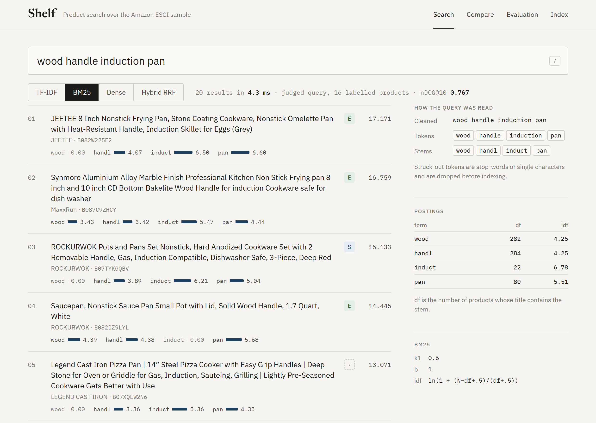

| Member | Registration no. | Part |
| --- | --- | --- |
| Tanishq Choudhary | 23FE10CSE00664 | Inverted index, TF-IDF, BM25, search interface |
| Chinta Sri Durga Rohit | 23FE10CSE00596 | Data preparation, evaluation pipeline, hybrid RRF |
| Ishan Ravishankar | 23FE10CSE00641 | Dense retrieval with Sentence Transformers |

## Results in short

On the 700 test queries, ranking all 19,876 products:

| Model | P@10 | R@10 | R@100 | MAP | nDCG@10 | ms / query |
| --- | ---: | ---: | ---: | ---: | ---: | ---: |
| TF-IDF | 0.322 | 0.440 | 0.796 | 0.395 | 0.527 | 0.3 |
| BM25 | 0.346 | 0.471 | 0.806 | 0.436 | 0.570 | 0.3 |
| Sentence Transformer | 0.339 | 0.462 | 0.823 | 0.417 | 0.556 | 13.1 |
| **Hybrid (RRF)** | **0.363** | **0.496** | **0.860** | **0.463** | **0.600** | 14.2 |

Re-ranking only the ~20 judged candidates of each query (ESCI Task 1):

| Model | P@10 | R@10 | MAP | nDCG@10 |
| --- | ---: | ---: | ---: | ---: |
| Random order | 0.440 | 0.575 | 0.517 | 0.696 |
| TF-IDF | 0.487 | 0.664 | 0.627 | 0.778 |
| BM25 | 0.488 | 0.664 | 0.639 | 0.781 |
| Sentence Transformer | 0.487 | 0.656 | 0.634 | 0.786 |
| Hybrid (RRF) | 0.490 | 0.666 | 0.639 | 0.786 |

What we took from this:

- Over the full catalog the hybrid beats every single model, and a Wilcoxon test puts each of those
  differences at p < 0.001. It gains most in Recall@100 (0.860 against 0.806 for BM25).
- Tuned BM25 is the best single model and about 40 times faster than the dense one.
- When re-ranking, the four models end up within 0.008 nDCG@10 of each other. The candidates were
  already picked by Amazon's search for that query, so what is left is telling Exact from Substitute,
  and a title often doesn't say enough for that.

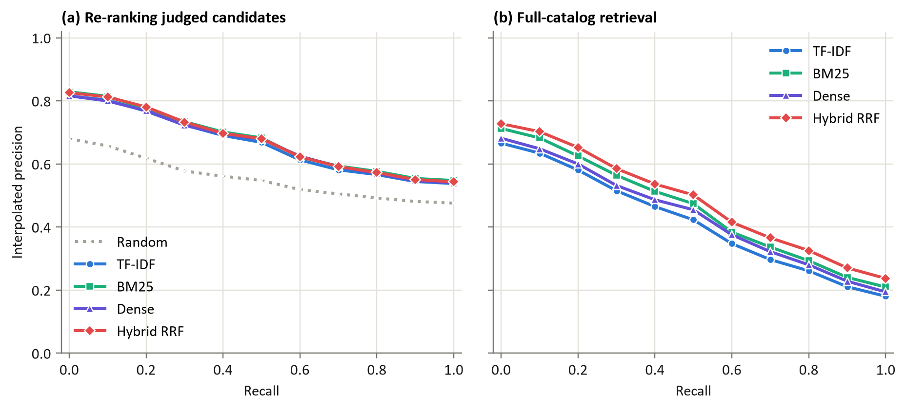

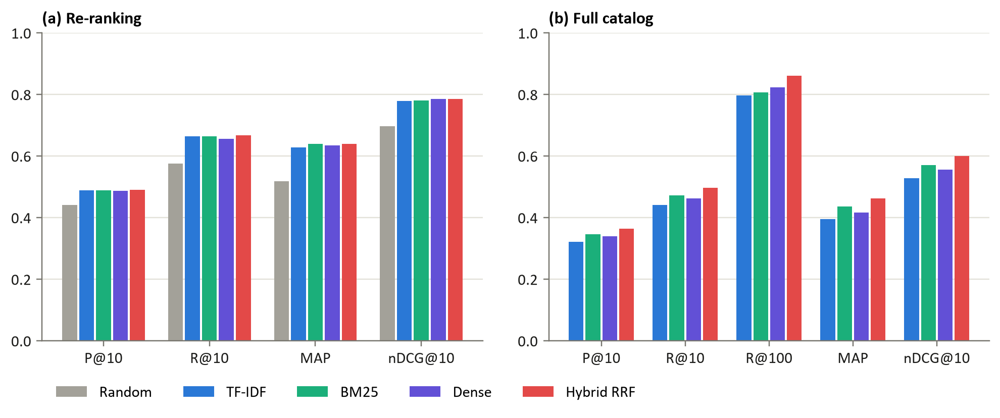

## Where BM25 and the dense model disagree

Per query, the dense model beats BM25 on 313 test queries and loses on 339. They fail on different
things, which is why fusing them helps.

| Query | BM25 | Dense | Hybrid | Why |
| --- | ---: | ---: | ---: | --- |
| brown flats for women | 0.86 | 0.00 | 0.52 | colour has to match |
| 14 gallon trash can | 0.78 | 0.28 | 0.80 | size has to match |
| tidy die | 1.00 | 0.00 | 1.00 | rare brand name |
| go pro camera | 0.00 | 0.86 | 0.50 | titles write "GoPro" |
| ashwaghanda extract | 0.38 | 0.96 | 0.86 | misspelling |
| hinatab | 0.00 | 0.66 | 0.35 | no stem in the index at all |

nDCG@10, full catalog.

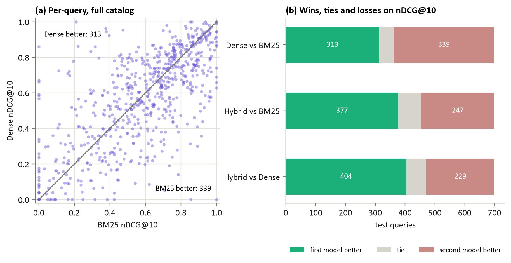

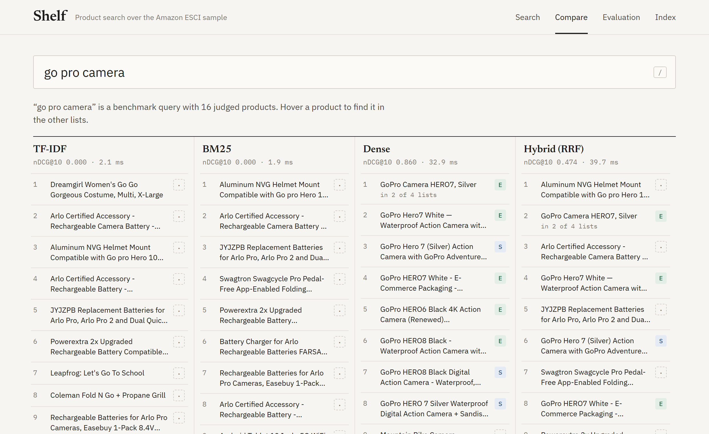

## Data

`data/benchmark_sample.parquet` has 1,000 English queries from the test split of the ESCI reduced
version, with all 20,156 judged query-product pairs over 19,876 products. Each pair is labelled
**E**xact, **S**ubstitute, **C**omplement or **I**rrelevant. Products are indexed by title, with the
brand added when the title doesn't already contain it. The full dataset (about 1.1 GB) is at
<https://github.com/amazon-science/esci-data> and isn't needed to run anything here.

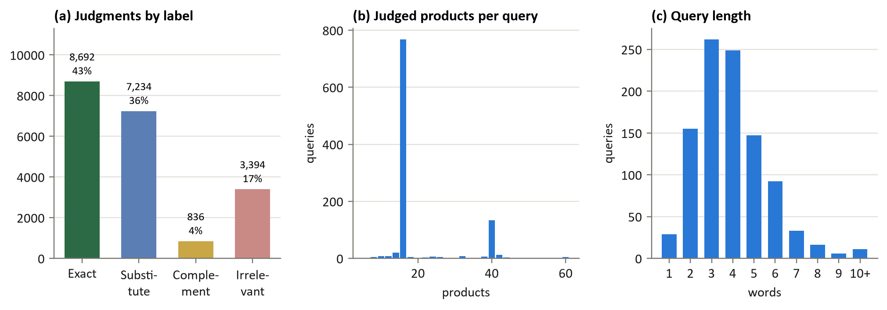

79% of the judged pairs are Exact or Substitute. Our first evaluation counted both as relevant and
every model scored P@10 around 0.84, which mostly measured that. Binary metrics now count only Exact;
nDCG still uses all four grades (E 3, S 2, C 1, I 0).

## How it works

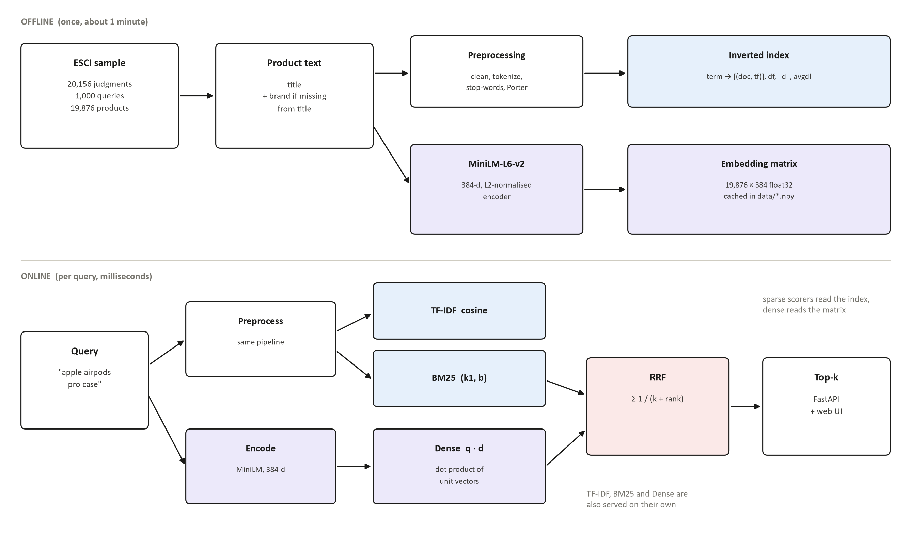

**Preprocessing** (`src/preprocessing.py`): HTML unescape and tag removal, lower-casing, a tokenizer
that keeps `128gb`, `usb-c` and `8.5` whole, NLTK stop-words, Porter stemmer. The dense model gets the
cleaned text without stemming.

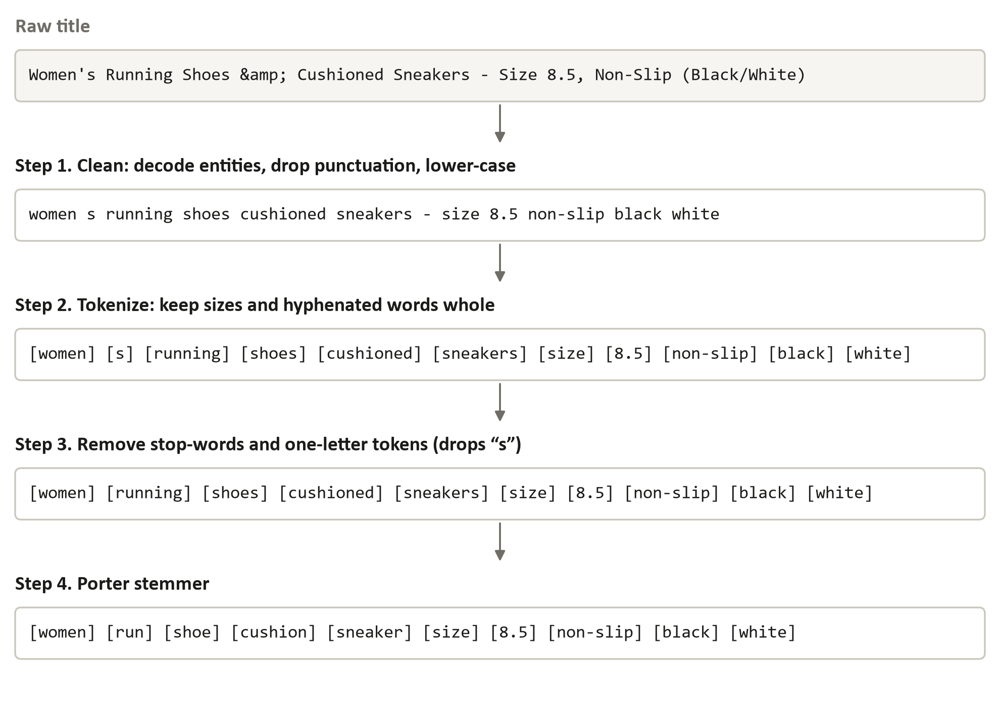

**Inverted index** (`src/indexing.py`): each stem maps to a postings list of (document, term frequency)
as numpy arrays, with document frequencies and title lengths. 30,010 stems and 274,924 postings for
the sample. A query only reads the postings of its own stems.

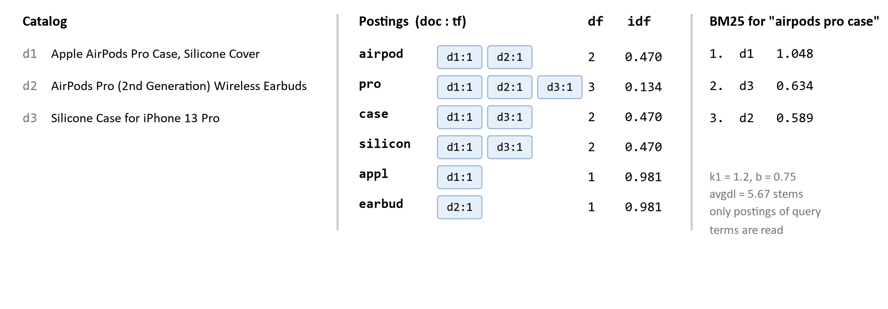

**Models** (`src/models/`)

| Model | File | Notes |
| --- | --- | --- |
| TF-IDF | `tfidf_ranker.py` | log tf, smoothed idf, cosine. Our scores match scikit-learn's TfidfVectorizer to 1e-9 |
| BM25 | `bm25_ranker.py` | Lucene-style idf (never negative), k1 = 0.6, b = 1.0 chosen on dev |
| Dense | `dense_ranker.py` | `all-MiniLM-L6-v2`, 384-d normalised embeddings, cosine |
| Hybrid | `hybrid_rrf.py` | RRF over the BM25 and dense lists, score = Σ 1/(k + rank), k = 10 |

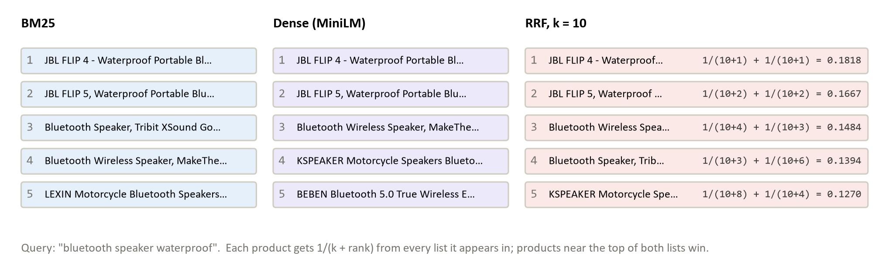

## Evaluation

The 1,000 queries are split once (seed 42) into 300 dev and 700 test queries. Every setting below was
chosen on dev, using the mean nDCG@10 of the two protocols. The test set was scored once.

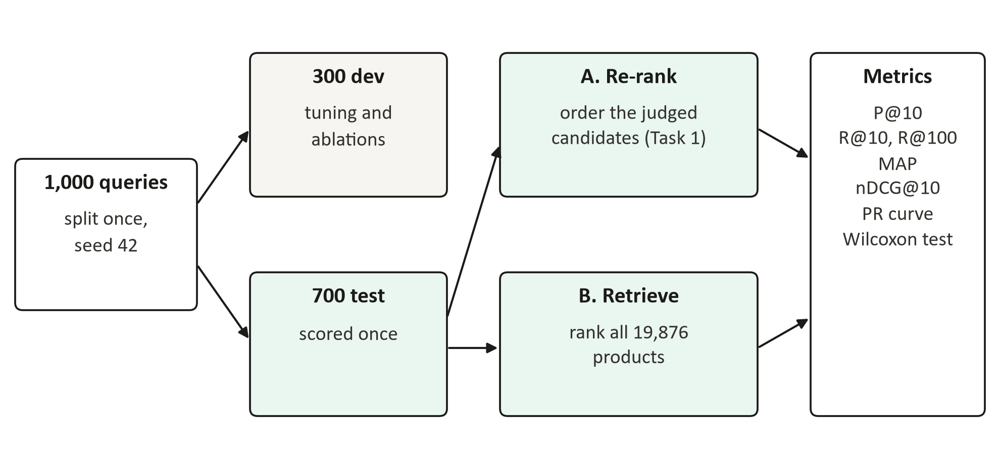

Before re-ranking, each query's candidate list is shuffled with a fixed seed. BM25 gives many
candidates the same score, and a stable sort would otherwise keep whatever order the file had.

**BM25 parameters.** k1 = 0.6, b = 1.0 beat the usual 1.2 / 0.75. Titles rarely repeat a word, so term
frequency should saturate early, and long titles are long because they list features.

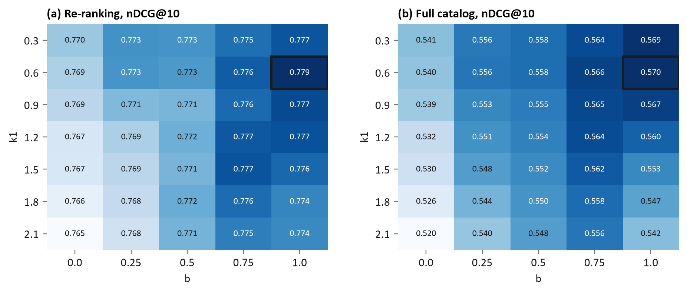

**TF-IDF weighting and preprocessing.** Stemming helps a lot (BM25 0.570 vs 0.530 on dev retrieval).
Removing stop-words slightly hurts, because shopping queries use words like "for" and "without".
In re-ranking a TF-IDF variant without idf came out on top but was the worst in retrieval, which is
why settings are picked on both protocols together.

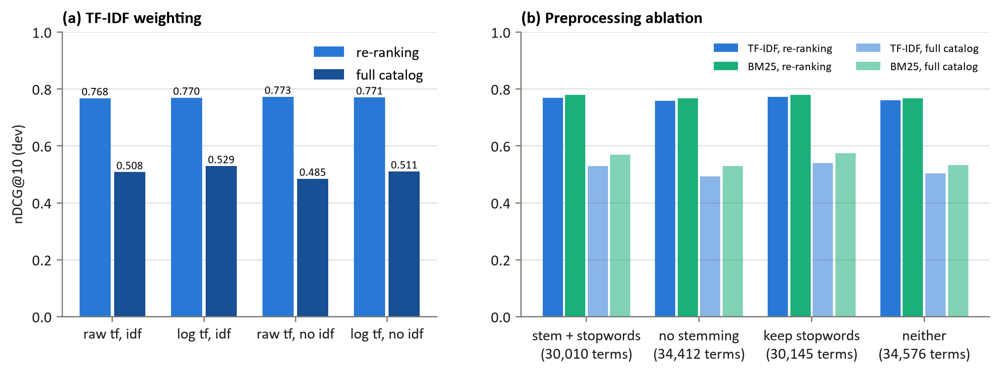

**RRF.** The constant k barely matters (at most 0.009 nDCG@10 across k = 1 to 200). Which lists you
fuse matters more. Adding TF-IDF as a third list makes it worse, because TF-IDF and BM25 make the same
mistakes.

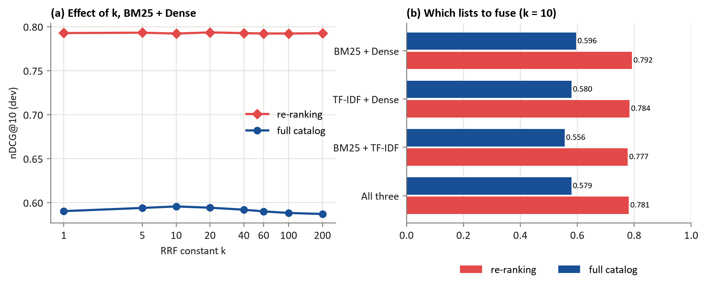

**By query length** the hybrid stays ahead in every group for retrieval. One- and two-word queries are
the hardest.

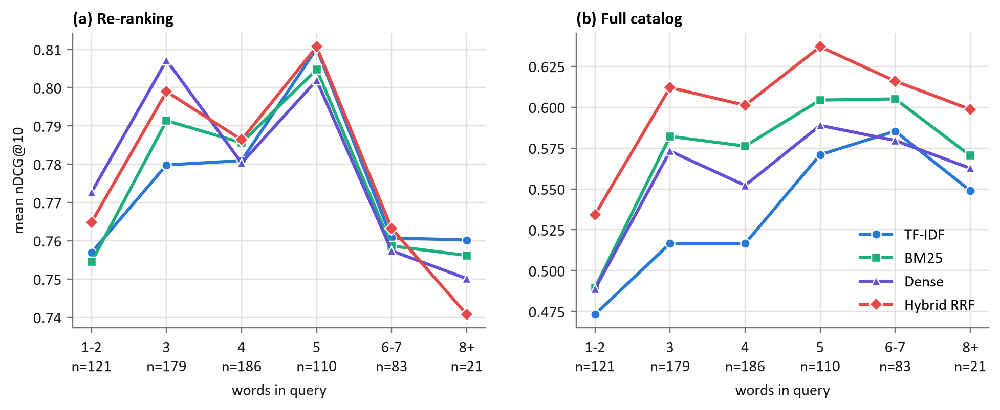

**Label mix by rank.** Random order gives about 45% Exact at every position. The models raise that to
62-66% at rank 1.

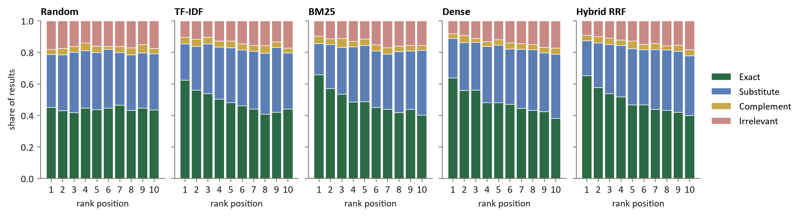

**Speed** on a laptop CPU, top 100 of 19,876 products. Building the index takes about 7 s; encoding the
catalog with MiniLM takes about a minute and a half and is cached in `data/`.

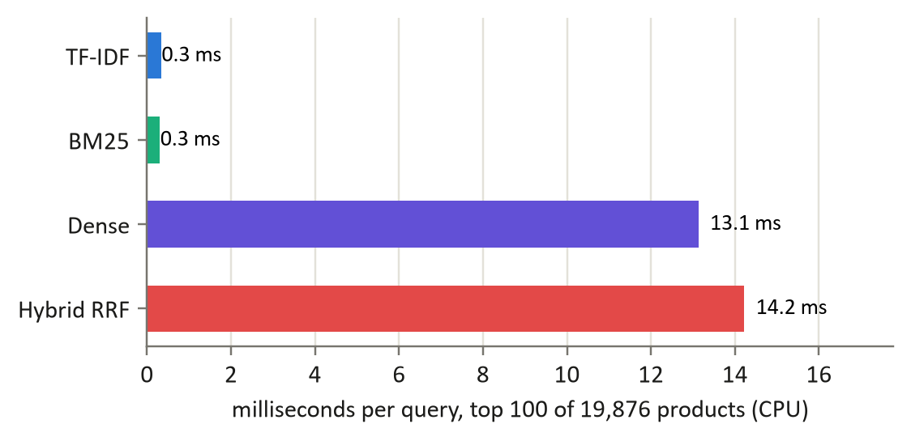

All result tables (per query too) are in `evaluation_results/`. `run_summary.json` has the chosen
settings, index size and timings.

## Running it

```bash
pip install -r requirements.txt
python -m unittest discover tests
python run_evaluation.py
python -m uvicorn backend.main:app --port 8000
```

The evaluation takes about 4 minutes; the first run also encodes the catalog. Then open
<http://localhost:8000>.

The interface has four pages:

- **Search.** One model at a time. TF-IDF and BM25 results show how much each query stem added to the
  score, and hybrid results show the BM25 and dense ranks that were fused. The side panel shows how the
  query was cleaned, tokenized and stemmed, with df and idf per stem. For any of the 1,000 benchmark
  queries the results carry their E/S/C/I label and the page shows nDCG@10.
- **Compare.** All four models side by side. Hover a product to find it in the other lists.
- **Evaluation.** The test tables, PR curves and the BM25 grid.
- **Index.** Vocabulary and postings size, the most common stems, the label mix.

To redraw the graphs: `python figures/make_figures.py` and `python figures/diagrams.py`.

## Layout

```
backend/main.py          FastAPI app
frontend/                web interface (HTML, CSS, JS, no build step)
src/preprocessing.py     text pipeline
src/indexing.py          inverted index
src/models/              the four rankers
src/evaluation.py        metrics and the two protocols
run_evaluation.py        dev tuning, test run, analysis tables
evaluation_results/      results (CSV, JSON)
figures/                 graphs, diagrams and the scripts that draw them
tests/                   unit tests
notebooks/               exploratory data analysis
```
